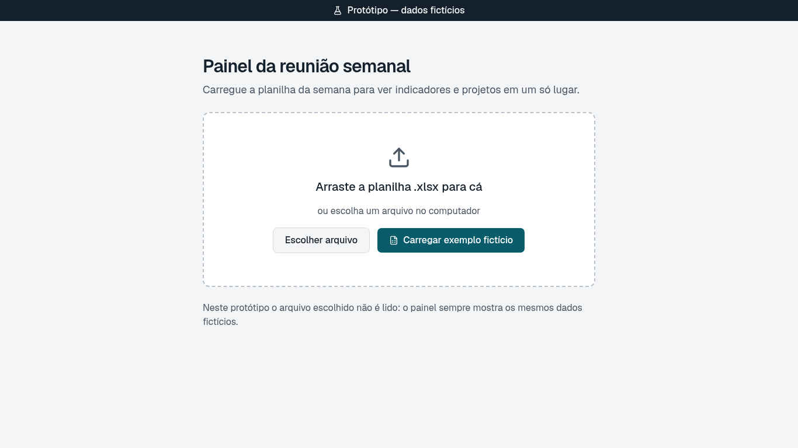
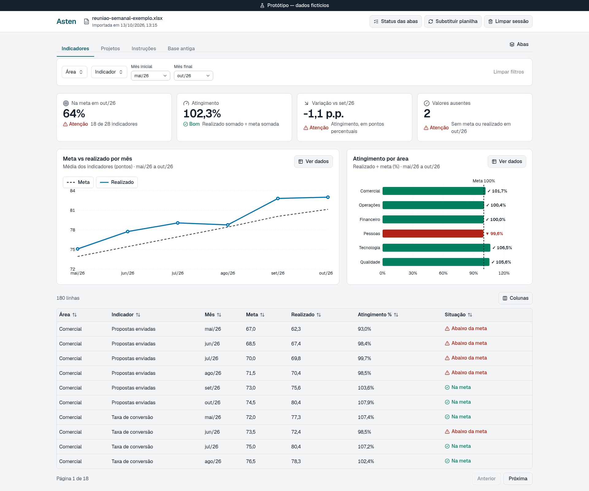
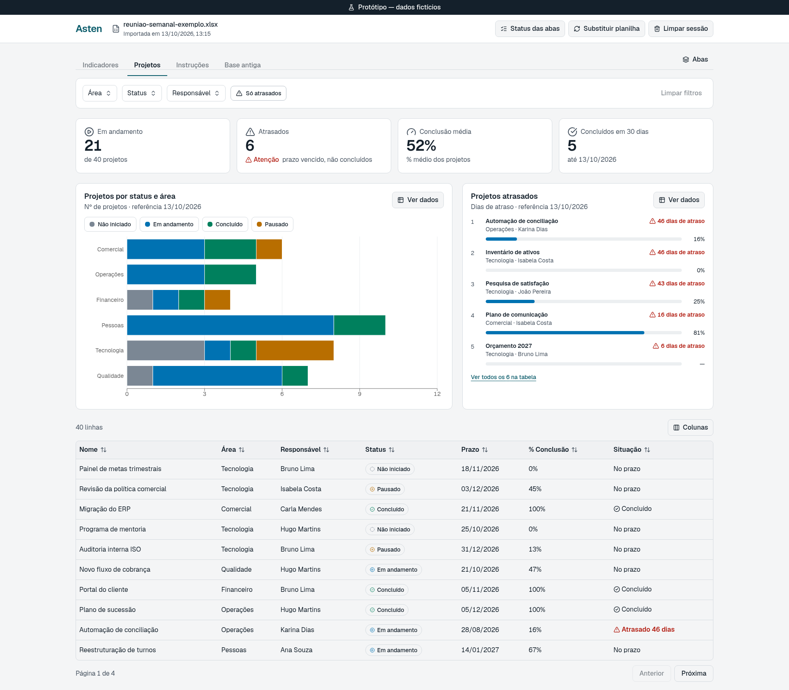
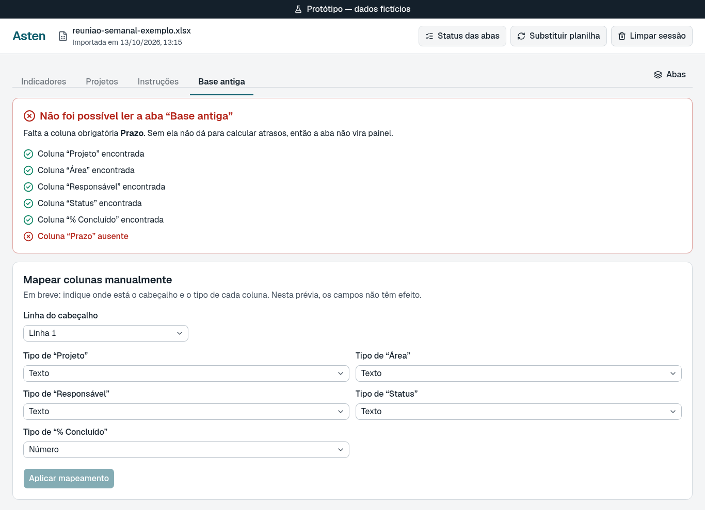
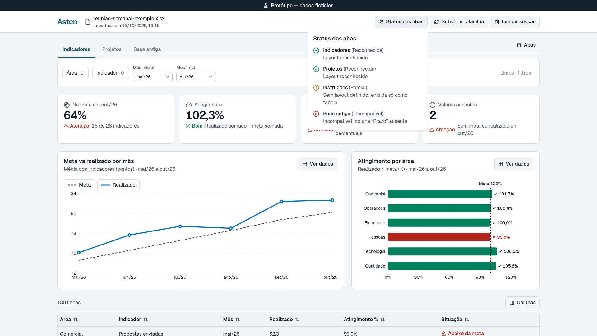
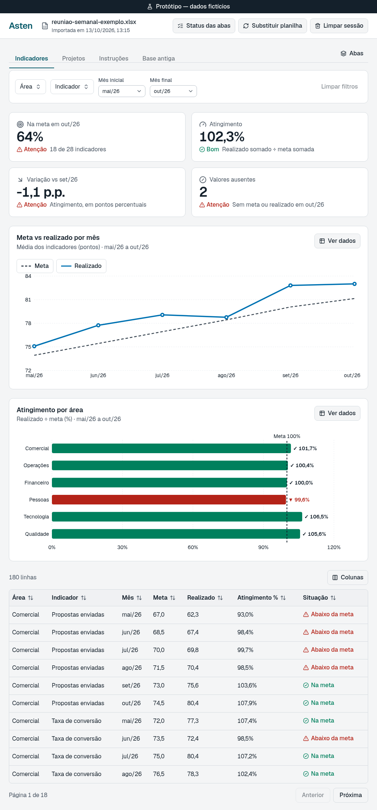

# Painel semanal Asten — alinhamento com o Líder

**Data:** 16/10/2026 · **Status:** planejamento + protótipo descartável · **Repositório:** `gomesbeduardo/dash-asten` (privado)

> Objetivo desta conversa: aprovar o escopo enxuto, a stack e a direção do protótipo, e responder às pendências que destravam o produto real. Nenhum código de produto foi escrito até aqui.

---

## 1. O problema, em uma frase

A reunião semanal projeta a planilha direto no Excel: as comparações são montadas à mão, filtrar ao vivo é desajeitado e a visão executiva se mistura com o detalhe.

## 2. A proposta

Um **painel local no navegador**. A facilitadora importa o `.xlsx` da semana, cada aba vira uma visão com **dashboard pronto**, e a reunião é conduzida por **filtros**.

**Por que não Power BI, Looker ou o próprio Excel?**
- **Privacidade:** a planilha nunca sai do computador. Não há servidor, nuvem nem login.
- **UX de reunião:** uma tela pensada para projetar e conduzir a conversa, em vez de uma ferramenta de análise genérica.

## 3. Escopo do MVP (decidido no grilling de 13/10)

| Entra | Fica para depois |
|---|---|
| Importar `.xlsx` localmente; todas as abas viram visões | Construtor de cartões e gráficos (adicionar, mover, configurar) |
| Dashboard **fixo** por aba, definido para a planilha-modelo | Renomear e reordenar abas |
| **Filtros por aba**, com chips removíveis e "limpar filtros" | Filtros que atravessam abas |
| Ocultar e reexibir abas | Exportar PNG/CSV e explicador no Claude Motion |
| Escolher as colunas visíveis na tabela de detalhe | Salvar preferências e links compartilháveis |
| Diagnóstico claro quando o arquivo foge do modelo | Previsões e IA |
| Visual sóbrio, legível em projeção, acessível (WCAG AA) | |

**Premissa central:** a planilha tem **a mesma estrutura toda semana**. Por isso o painel é feito sob medida para ela; não é um BI genérico.

## 4. Stack escolhida e por quê

| Camada | Escolha | Motivo principal |
|---|---|---|
| Aplicação | **React 19 + TypeScript + Vite** | É o maior ecossistema para dashboards. Gera um site estático que roda em qualquer lugar: Vercel, intranet ou pasta local. |
| Componentes | **shadcn/ui** (Tailwind v4) | O código fica no nosso repositório, sem dependência de fornecedor. Vem com gráficos e blocos de dashboard prontos e tem integração oficial com o Claude Code. |
| Gráficos | **Recharts 3** (via shadcn) | Cobre os gráficos de que precisamos (linha, barra, empilhada, KPI, progresso). Leve, licença MIT e ativo. |
| Tabela | **TanStack Table** | Ordenação e escolha de colunas visíveis prontas. |
| Leitura do Excel | **SheetJS 0.20.3+ (CDN oficial)** | Lê abas, datas e células mescladas. **A versão do npm tem falhas de segurança conhecidas e está proibida.** |

**Comparadas e descartadas:** Vue e Svelte (menos componentes de dashboard); Astro (feito para conteúdo estático); Astryx da Meta (ainda em beta, gráficos instáveis); Tremor (parado há quase 2 anos); dashboardcn (sem licença definida); Aceternity (efeitos de landing page); Plotly (pesado demais); visx (baixo nível demais). **Plano B para gráficos:** ECharts.
Detalhes, versões e fontes em `docs/comparacao-stack.md`.

## 5. Resultado parcial

- ✅ **Grilling** de produto: 16 decisões registradas (PRD §0).
- ✅ **PRD v2 e plano v2** reescritos com o escopo enxuto; a v1 fica no histórico do Git.
- ✅ **Comparação de stack**, com versões e licenças verificadas em 13/10.
- ✅ **Repositório privado** criado, com bloqueio de planilhas reais no Git.
- ✅ **Protótipo descartável** em React local (`prototype/`), na stack escolhida e com **dados fictícios**. Cobre as duas hipóteses de conteúdo:
  - **Indicadores:** meta vs. realizado por mês e área, com KPIs, o gráfico principal, o atingimento por área e a tabela;
  - **Projetos:** status por área, atrasados, % de conclusão e a tabela;
  - mais uma aba sem layout ("Instruções"), que vira só tabela, e uma aba incompatível ("Base antiga"), com diagnóstico e o mapeamento de fallback.

  **O que já dá para testar nele:** filtros por aba com chips e "limpar"; ocultar série pela legenda; "Ver dados" (tabela alternativa ao gráfico); escolher colunas da tabela; ocultar e reexibir abas; status das abas; substituir planilha ou limpar sessão com confirmação.

  **Verificado em 13/10:** typecheck, lint e build limpos; 11 checagens de interação automatizadas no Chrome passando, sem erros de console; capturas em 1920×1080, 1366×768 e 1024px.

  *Como rodar:* `cd prototype && npm install && npm run dev`.

| Tela | Captura |
|---|---|
| Estado vazio / upload |  |
| Indicadores (1920) |  |
| Projetos (1920) |  |
| Aba incompatível + mapeamento |  |
| Status das abas |  |
| Largura menor (1024) |  |

> O protótipo serve para reagir ao **visual e à interação**. Os números e as métricas são inventados e não representam a planilha real. A cor da marca (azul-petróleo) é provisória, até recebermos a identidade da Asten.

**Perguntas para o Líder sobre o protótipo:**
- A hierarquia faz sentido para a reunião: KPIs no topo, um gráfico principal, um complementar e a tabela?
- A densidade está boa para projetar, ou é melhor ter menos informação por tela?
- Quais desses KPIs de exemplo se parecem com o que a reunião realmente discute?

## 6. O que precisa ser analisado e decidido pelo Líder

Esses itens **bloqueiam o produto real** (não o protótipo):

1. **A planilha real**, ou uma cópia anonimizada com a mesma estrutura. Sem ela não existe contrato de dados.
2. **O conteúdo:** a planilha acompanha indicadores, projetos/atividades ou os dois?
3. **As perguntas da reunião:** que pergunta cada gráfico precisa responder? Quais métricas, fórmulas e metas entram?
4. **As definições:** o que conta como backlog, atraso e concluído; janela de 1–2 meses; semana de corte.
5. **Os filtros:** quais dimensões filtram cada aba (área, responsável, status…)?
6. **O layout:** fica fixo no código (recomendado) ou é gerado automaticamente?
7. **Onde o painel roda:** Vercel com acesso protegido, intranet ou arquivo local?
8. **O volume:** quantas linhas e abas no pior caso. Isso define os limites e o desempenho.
9. **A marca:** logo, cor principal e fonte. Hoje há um placeholder.
10. **A aprovação** do escopo enxuto (seção 3) e da direção do protótipo.

## 7. Riscos que já estão mapeados

- **Estrutura da planilha mudar** entre semanas: o diagnóstico mostra o que quebrou em vez de falhar em silêncio.
- **Planilha como vetor de ataque:** o arquivo é tratado como não confiável; nada de fórmulas, macros ou HTML é executado, e a leitura usa a versão corrigida do SheetJS.
- **Dados sensíveis na projeção:** só aparece o que o layout define; fechar a aba apaga tudo.
- **Contraste na projeção:** a paleta será validada com ferramenta de acessibilidade.

## 8. Próximos passos depois do "sim"

```text
Planilha real + respostas da seção 6
  → contrato de dados por aba          [aprovação do Líder]
  → fundação do produto (com testes)
  → leitura do Excel e diagnóstico → filtros → dashboards de cada aba
  → acessibilidade, desempenho e segurança → validação em projeção
```
